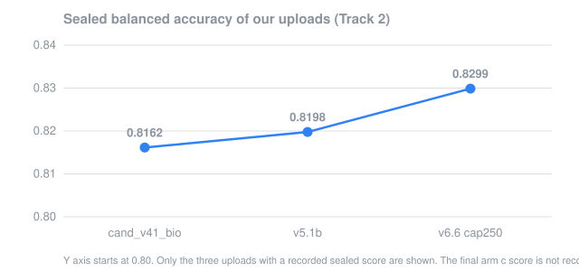
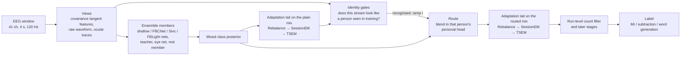
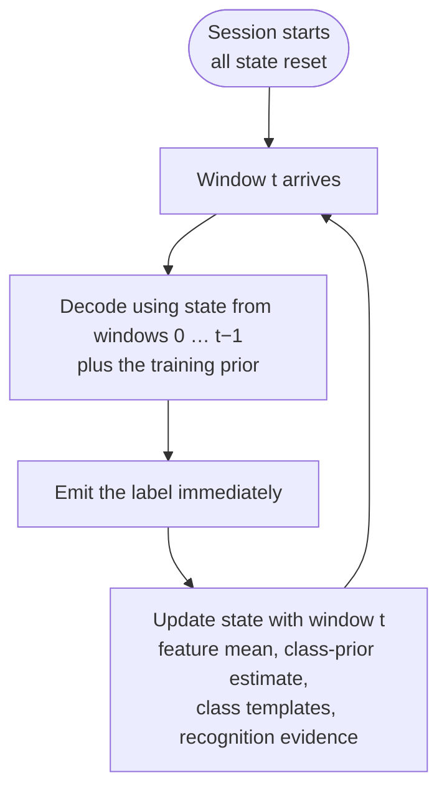
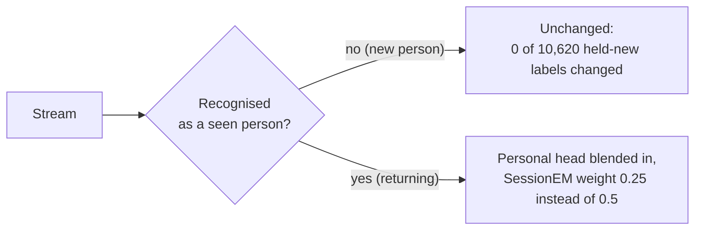

# Friday · Neural Interfaces 2026, Track 2 (BCI decoding)

Research code and experiment record for our entry in **Track 2 of the [Neural Interfaces 2026](https://github.com/neural-interfaces26/2026-competition) competition** (NeurIPS 2026 Brain and Body Workshop): decoding mental commands from short EEG windows, for people the decoder has never seen, with no labels at test time.

This is a research archive, not a library. It contains the decoder source, the pre-registered experiment ledger, the evidence behind every claim, and the cluster scripts used to train and score. Read it to see what was tried, what worked and what did not. Re-running everything needs the data, GPU clusters and weights described under [Reproducing](#reproducing), and several of those are not included.

## The task

One four-second, 41-channel EEG window at 120 Hz goes in, and one of three classes comes out immediately: **kinesthetic motor imagery, mental subtraction, or word generation**.

- The decoder gets no labels, no person ID and no guarantee about recording order. It starts fresh each session.
- The score is balanced accuracy, averaged equally over cells (participant, session, interface). Seen (returning) and unseen (new) people are scored separately and averaged unweighted.
- The sealed run has a 3,600 s budget on one RTX PRO 4500.
- The public warm-up data is the PROTEUS release ([NEMAR nm000290](https://doi.org/10.82901/nemar.nm000290)). The sealed recordings are private and were never available to us.

The full contract, with sources, is in [OFFICIAL_CONTRACT.md](OFFICIAL_CONTRACT.md).

## Results

| | Sealed balanced accuracy | Notes |
|---|---|---|
| Best recorded sealed upload (`v6.6 cap250`, submission 1058969) | **0.8299** | 2,555 s runtime, about rank 15–16 on the live table on 19 Nov |
| Earlier package (`v5.1b`, submission 1050185) | 0.8198 | 1,287 s |
| Final upload (arm c) | not recorded here | Qualified on public data, see [the decision](evidence/wave_20nov/arm_c_sprint_21nov.md). Official rankings stay provisional until the organisers' reproducibility audit. |

Development numbers use ten held-out PROTEUS people and two returning people. They are reading aids with wide intervals (about ±0.5 percentage points across people), not private-set predictions. Where a claim depends on a validity caveat, [docs/STATE.md](docs/STATE.md) says so, including the 18 Nov scoring audit and the 20 Nov red-team finding that some returning-person levels were inflated.

## The final system

The decoder is a routed ensemble with label-free adaptation at test time, not a single network. "Test time" means while it decodes a new person's session, after training is finished. The trained weights stay fixed. What adapts is a small amount of state, built only from the windows of the current session seen so far and thrown away when the session ends.

### Pipeline

The member list is the family inventory in [cleanslate/cap250/SPEC.md](cleanslate/cap250/SPEC.md). The two tails, the gates and the route are described in `lean/src/stages.py` and `lean/src/routing.py`. The C++/CUDA port in [native/](native/) reproduces this chain to fit the 3,600 s budget.

### What adapts while a session runs

The state used at each step:

| Stage | What it does |
|---|---|
| Feature re-centring | Band-wise covariance features are re-centred on the log-Euclidean mean of the session's windows so far, with the training mean as a prior worth about two windows. Training sessions get per-session Euclidean alignment. |
| `Rebalance` | Divides the posterior by the running mean of the recent outputs raised to a power, with a uniform prior, so a session cannot drift into one class. |
| `SessionEM` | Fits per-session Gaussian class templates on earlier windows in a view of frontal slow potentials and ocular-event rates, then reweights the current window. It is gated by the session's input margin. |
| `TSEM` | Per-session class templates in the leading principal components of one core model's features. The most confident earlier windows per class give a mean, and their pooled covariance gives an LDA likelihood. |
| Identity gates and route | Decide whether a stream looks like a person seen in training. If so, part of the mix is replaced by that person's personal head, with a ramp that grows with confidence. |
| Count filter | A run-level filter, with the form and fit in the ledger. |

### Arm c, the final upload

Arm c is the cap250 system with one change: on streams the gates recognise, the `SessionEM` emission weight is lowered from 0.5 to 0.25 (normalised `p^0.75 · q^0.25`). Streams from new people are untouched.

This was a small, cautious move. On fresh PROTEUS orders with full-session delivery it changed returning-person balanced accuracy by +0.18 pp (80% interval −0.00 to +0.36) and the 50/50 new/returning figure by +0.09 pp. Within-run delivery gave +0.16 and +0.08 pp. These intervals touch or include zero. It was chosen over three further candidates that each missed a promotion criterion ([sprint record](evidence/wave_20nov/arm_c_sprint_21nov.md)), and its qualification is in [evidence/wave_20nov/arm_c_confirmation.md](evidence/wave_20nov/arm_c_confirmation.md). Its sealed score is not recorded here.

## How we worked

Every change was pre-registered in [docs/LEDGER.md](docs/LEDGER.md) with a numeric prediction and a refutation rule before it was scored, and was judged inside the full system under shuffled delivery orders. Most ideas were refuted or left undecided, and those records stay in.

## The experiments along the way

The full trail is here, not only the final system: about 3,000 commits since 17 Oct, the ledger with every pre-registered run (mechanism, numeric prediction, refutation rule, then result), the scripts and logs behind each entry under `evidence/`, `studies/`, `experiments/` and the `lane*/` directories, and the failures and closed directions. The original campaign's ledger sits in the history (`git show a5843492:docs/LEDGER.md`). Large result arrays were removed before release, so some entries keep only logs, scripts and summaries ([history note](docs/HISTORY.md)).

## Repository map

| Path | Contents |
|---|---|
| [docs/STATE.md](docs/STATE.md) | Current state, final submission, validity caveats. Start here. |
| [docs/LEDGER.md](docs/LEDGER.md) | The pre-registered experiment ledger |
| [OFFICIAL_CONTRACT.md](OFFICIAL_CONTRACT.md) | Competition rules and data contract, with sources |
| `submissions/` | Single-file `submission.py` packages for each uploaded version. Their SHA-256 values are pinned, so do not edit them. |
| `lean/` | The v5.1b inference source rewritten as small modules, with a bit-exact parity record |
| `cleanslate/` | From-scratch rebuilds of the cap250 system, harness and member families |
| `native/` | C++/CUDA training and inference port, plus vendored SciPy L-BFGS-B |
| `replay/` | Scorer that replays the packaged chain on public data. `python replay/check.py` must print `OK` before chain results are trusted. |
| `studies/`, `experiments/`, `scripts/` | Dated studies, experiment code, data export and Slurm helpers |
| `friday/`, `evidence/`, `lane*/`, `niv/`, `revisit/` | Per-experiment code, logs and result files, indexed from the ledger |
| [docs/HISTORY.md](docs/HISTORY.md) | Note on the one-time history rewrite, and a map from old to new commit hashes |
| `2026-competition/` | Official competition repository as a pinned submodule, unchanged |

## Reproducing

What you need:

1. **Environment.** Python 3.13 and the pins in [requirements/cloud.txt](requirements/cloud.txt) (a macOS arm64 baseline is in `requirements/baseline-macos-arm64.txt`).
2. **Official code.** `git submodule update --init` for `2026-competition/`.
3. **Data.** Download PROTEUS from NEMAR, then build the window export with `python scripts/export_windows.py`. It writes to `data/`, which is not tracked. Replay inputs are checked against [replay/data.sha256](replay/data.sha256).
4. **Check the replay.** `python replay/check.py` reproduces the six reference development scores of the packaged chain. This only guards the v3 chain in recording order. It does not measure private-set performance.

Limits you should know about:

- **Not included:** trained weights, datasets, and generated arrays (`*.npz`, `*.npy`). The final 417 MB `submission.zip` is not stored here. Its SHA-256 is in [docs/STATE.md](docs/STATE.md#final-track-2-submission).
- **Cluster paths:** training and scoring scripts target the Galvani (Tübingen) and Leonardo (CINECA) Slurm clusters. Paths such as `/mnt/lustre/...`, account names and job IDs belong to those systems and need editing for yours.
- **Records, not clean code:** many scripts are one-off experiment drivers kept as the evidence for a ledger entry. Some logs and notes show `<repo>` and `<home>` where a local path was removed before release.
- **Native CPU replay** is not proof that the Linux GPU worker gives the same outputs.

## Data and model licences

Original dataset and model licences remain in force. PROTEUS is distributed through NEMAR under its own terms, and the Scherer corpus under the terms declared in the ledger. Third-party code bundled here keeps its own notice: [native/vendor/scipy_lbfgsb](native/vendor/scipy_lbfgsb) (SciPy) and [native/worker-parity/DUCC-LICENSE.md](native/worker-parity/DUCC-LICENSE.md). The competition submodule is under the organisers' terms.

## Licence

No licence has been chosen for the code in this repository yet. Until a `LICENSE` file is added, all rights are reserved by the author.

## Contact

Open an issue on this repository.
