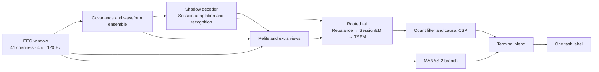
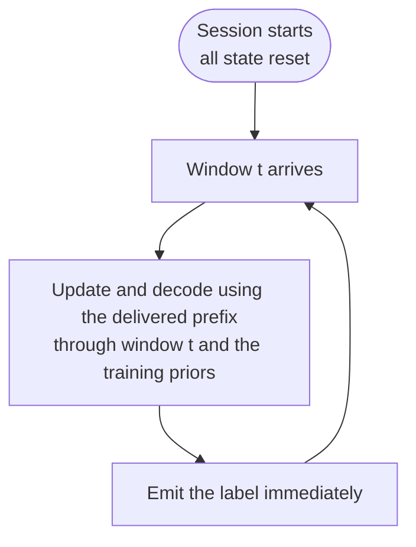
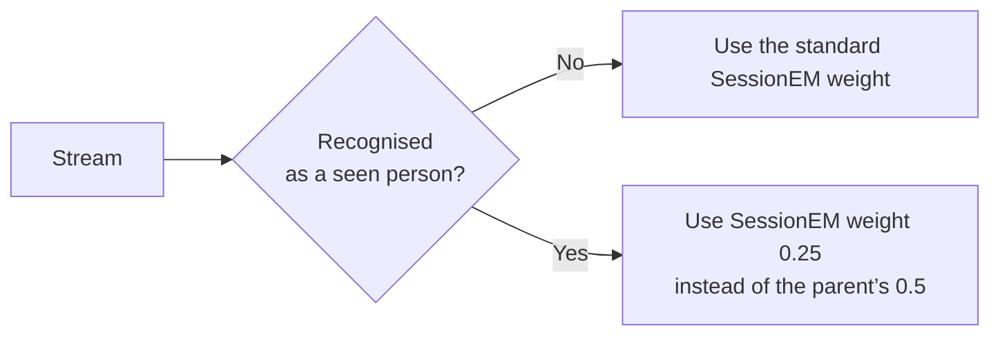

# Friday · Neural Interfaces 2026, Track 2 (BCI decoding)

Research code and experiment record for our entry in **Track 2 of the [Neural Interfaces 2026](https://github.com/neural-interfaces26/2026-competition) competition** (NeurIPS 2026 Brain and Body Workshop): decoding mental tasks from short EEG windows from new and returning participants without test-time labels.

The repository contains the decoder source, experiment code, preregistrations, and validation records. Start with the [final decoder](#the-final-system) or browse the [experiment lanes](experiments/lanes/).

## The task

One four-second, 41-channel EEG window at 120 Hz goes in, and one of three classes comes out immediately: **kinesthetic motor imagery, mental subtraction, or word generation**.

- The decoder gets no labels, no person ID and no guarantee about recording order. It starts fresh each session.
- The score is balanced accuracy, averaged equally over cells (participant, session, interface). Seen (returning) and unseen (new) people are scored separately and averaged unweighted.
- The sealed run has a 3,600 s budget on one RTX PRO 4500.
- The public warm-up data is the PROTEUS release ([NEMAR nm000290](https://doi.org/10.82901/nemar.nm000290)). The sealed recordings are private and were never available to us.

The full contract, with sources, is in [OFFICIAL_CONTRACT.md](OFFICIAL_CONTRACT.md).

## Results

| | Sealed balanced accuracy | Notes |
|---|---|---|
| Best recorded sealed upload (`v6.6 cap250`, submission 1058969) | **0.8299** | 2,555 s runtime, about rank 15–16 on the live table on 19 Nov |
| Earlier package (`v5.1b`, submission 1050185) | 0.8198 | 1,287 s |
| Final upload (arm c) | not recorded here | Qualified on public data. [Final decision and qualification](evidence/wave_20nov/arm_c_confirmation.md). |

Development numbers use ten held-out PROTEUS people and two returning people. They are reading aids with wide intervals (about ±0.5 percentage points across people), not private-set predictions. Where a claim depends on a validity caveat, [docs/STATE.md](docs/STATE.md) says so, including the 18 Nov scoring audit and the 20 Nov red-team finding that some returning-person levels were inflated.

## The final system

The decoder combines several models and adapts while it processes a session. It updates running statistics, fits class templates, and can refit selected members using its own predictions. It uses only the current session’s delivered EEG and resets its state between sessions.

### Pipeline

The [cap250 specification](cleanslate/cap250/SPEC.md) describes the base member families. The final Python Solver builds
on this stack with the Team B encoder blend and a terminal MANAS-2 contribution of 10% when active. The
[C++/CUDA worker](native/worker-parity/) is a separate parity study.

### What adapts while a session runs

The state used at each step:

| Stage | What it does |
|---|---|
| Feature re-centring | Band-wise covariance features are re-centred on the log-Euclidean mean of the session's windows so far, with the training mean as a prior worth about two windows. Training sessions get per-session Euclidean alignment. |
| `Rebalance` | Divides the posterior by the running mean of the recent outputs raised to a power, with a uniform prior, to counter drift toward one class. |
| `SessionEM` | Fits per-session Gaussian class templates on earlier windows in a view of frontal slow potentials and ocular-event rates, then reweights the current window. It is gated by the session's input margin. |
| `TSEM` | Per-session class templates in the leading principal components of one core model's features. The most confident earlier windows per class give a mean, and their pooled covariance gives an LDA likelihood. |
| Identity gates and route | Decide whether a stream looks like a person seen in training. If so, part of the mix is replaced by that person's personal head, with a ramp that grows with confidence. |
| Member refits | Update selected members with the decoder’s own labels under a capped schedule. |
| Count filter and causal CSP | Apply a count prior and a spatial-filter correction using the delivered prefix. |

### Arm c, the final upload

Arm c changes one setting in the signed `em_half` parent: on streams the gates recognise, the `SessionEM` emission weight is lowered from 0.5 to 0.25 (normalised `p^0.75 · q^0.25`). Streams that never trigger recognition follow the same path as in the parent.

Across fresh full-session PROTEUS orders, arm c gained **+0.089 percentage points** in 50/50 new/returning balanced
accuracy (paired 80% interval −0.001 to +0.179). Within-run delivery gave +0.080 pp (−0.047 to +0.197).
Across both schemes, 0 of 21,240 held-new labels changed. These development runs reuse participants across orders.
See the [arm c patch](scripts/bottleneck_21nov/diet_decomposition_patch.py) and
[qualification record](evidence/wave_20nov/arm_c_confirmation.md).

## Experiments

Browse the [experiment lanes](experiments/lanes/) by topic. The [ledger](docs/LEDGER.md) records preregistrations and
results, including refuted and undecided directions. The original campaign ledger is also in Git history
(`git show a5843492:docs/LEDGER.md`).

## Repository map

| Path | Contents |
|---|---|
| [docs/STATE.md](docs/STATE.md) | Current state, final submission, validity caveats. Start here. |
| [docs/LEDGER.md](docs/LEDGER.md) | The pre-registered experiment ledger |
| [OFFICIAL_CONTRACT.md](OFFICIAL_CONTRACT.md) | Competition rules and data contract, with sources |
| `submissions/` | Single-file `submission.py` packages for each uploaded version. Their SHA-256 values are pinned, so do not edit them. |
| `lean/` | The v5.1b inference source rewritten as small modules, with a bit-exact parity record |
| `cleanslate/` | From-scratch rebuilds of the cap250 system, harness and member families |
| `native/` | C++/CUDA training and inference port, plus vendored SciPy L-BFGS-B |
| `replay/` | Scorer that replays the packaged chain on public data. `python replay/check.py` must print `OK` before chain results are trusted. |
| [experiments/lanes/](experiments/lanes/) | Experiment source grouped by topic, with original lane IDs and checkout instructions |
| [evidence/](evidence/), [studies/](studies/), [friday/](friday/) | Result records, dated studies, and campaign scripts |
| [scripts/](scripts/) | Data export, package checks, and Slurm helpers |
| [docs/HISTORY.md](docs/HISTORY.md) | Note on the one-time history rewrite, and a map from old to new commit hashes |
| `2026-competition/` | Official competition repository as a pinned submodule, unchanged |

## Reproducing

What you need:

1. **Environment.** Python 3.13 and the pins in [requirements/cloud.txt](requirements/cloud.txt) (a macOS arm64 baseline is in `requirements/baseline-macos-arm64.txt`).
2. **Official code.** `git submodule update --init` for `2026-competition/`.
3. **Data.** Download PROTEUS from NEMAR and run `python scripts/export_windows.py` to build the window export in `data/`.
4. **Replay inputs.** Place the saved development inputs listed in [replay/data.sha256](replay/data.sha256) in
   `runs/replay_data/` or set `NI26_REPLAY_DATA` to their directory. These inputs include member posteriors and features
   from prior fits. The window export alone cannot recreate them.
5. **Replay check.** Run `python replay/check.py`. It checks six v3 development scores in recording order.
   See [validation limits](docs/STATE.md#validity-caveat-18-nov-scoring-audit) for shuffled and returning-participant evaluations.

Historical launchers use the original checkout layout and cluster paths. See the
[experiment checkout instructions](experiments/lanes/) before using them. Get datasets from their original providers. The replay
arrays and trained weights live outside this repository. The final archive’s SHA-256 is in
[docs/STATE.md](docs/STATE.md#final-track-2-submission).

## License

Repository code is licensed under the [Apache License 2.0](LICENSE). Third-party code retains its original terms.
See the [SciPy notice](native/vendor/scipy_lbfgsb/NOTICE.md), [DUCC license](native/worker-parity/DUCC-LICENSE.md),
and [Pratibha-2 source](https://huggingface.co/MannasAI/pratibha-2/tree/863edc940d82a02744776a7820641bf1bc32310b).
Datasets, pretrained models, and the competition submodule retain their own terms.
